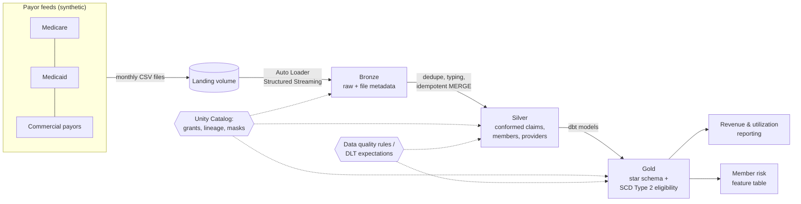

# claims-lakehouse

A healthcare claims lakehouse on Databricks, built with **synthetic data only** (no PHI). It simulates monthly claim feeds from multiple payors (Medicare, Medicaid, commercial plans) and takes them through a governed medallion architecture to dimensional models for revenue and utilization reporting.

**Why this repo exists:** a hands-on practice ground for patterns I use professionally (Databricks, medallion architecture, SCD Type 2, data quality, Unity Catalog), extended with tools I'm adding: Spark Structured Streaming, dbt, Lakeflow Declarative Pipelines (DLT), Terraform, and Data Vault modeling.

## Target architecture



## Data

Generated with [Synthea](https://github.com/synthetichealth/synthea) (open-source synthetic patient generator): 578 synthetic Minnesota patients, ~37K claims, ~281K claim transactions (charges, payments, transfers), and 10 payors including self-pay.

| Folder | Contents | Purpose |
|---|---|---|
| `reference/` | patients, payers, payer_transitions, providers, organizations | Dimensions; eligibility history for SCD Type 2 |
| `clinical/` | encounters, conditions, procedures, medications | Diagnosis and procedure context |
| `backfill/` | claims + transactions before Jan 2024, one file per payor | Initial historical load |
| `feeds/` | claims + transactions from Jan 2024, one file per payor per month (676 files) | Incremental / streaming ingestion |

Data files are **not committed** (see `.gitignore`). Regenerate them with `data_gen/generate_synthea.ps1` (Windows) or `data_gen/generate_synthea.sh` (macOS/Linux).

## Setup (Databricks Free Edition)

1. Open `notebooks/00_setup_catalog_and_data.py` in Databricks and run the first two cells. They create the schema `workspace.claims_lakehouse` and the volume `raw`.
2. In Catalog Explorer, upload `claims_lakehouse_data.zip` to `/Volumes/workspace/claims_lakehouse/raw/upload/`.
3. Run the rest of notebook 00 to unpack the data into `staging/`.
4. Run `notebooks/01_drip_feed.py` to deliver the first month of payor files into `landing/`, then run the ingestion pipeline. Repeat to simulate new months arriving.

## Roadmap

See [docs/roadmap.md](docs/roadmap.md). Architecture decisions are recorded in [docs/adr/](docs/adr/).

## Repo layout

```
data_gen/      Synthea generation + payor-feed split scripts
notebooks/     Databricks notebooks (setup, drip feed, ingestion)
docs/          Roadmap and architecture decision records
```
